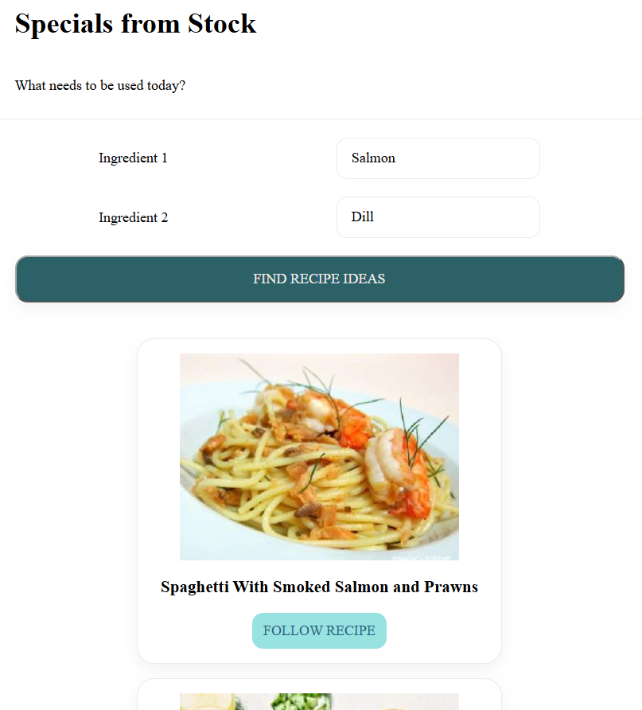

# 🍽️ Project: Simple API 2 - Restaurant

Users search for a meal or ingredient, such as `chicken`, `pasta`, or `salad`. The app uses the Spoonacular API to return recipe results, then uses the selected recipe ID to request and display the full recipe information.

## Project Goal
Build a simple front-end application that uses data returned from one API request to make a second API request and create a useful restaurant recipe tool.

## How It Works
- User searches for a recipe or ingredient
- Spoonacular Recipe Search API
- Returns recipe cards:id, title, image
- User selects a recipe
- The app sends the returned recipe ID to the Spoonacular Recipe Information endpoint
- The app displays the complete recipe details

## Technologies Used
- HTML
- CSS
- JavaScript
- Fetch API
- Spoonacular API

## API Used
### Spoonacular API
Spoonacular provides recipe, ingredient, food, and nutrition data.

## Future Improvements
- Add filters for cuisine, diet, meal type, or cooking time.
- Allow users to save favorite recipes.
- Add nutrition information.
- Add a shopping-list feature.

**live demo**

 https://clauya.github.io/simple-api-restaurant/